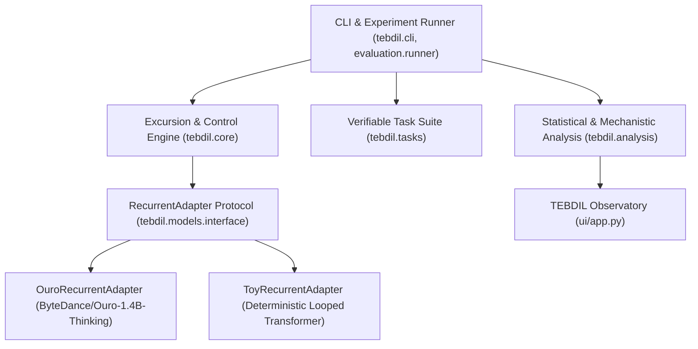

# TEBDIL Technical Architecture Specification

## 1. System Overview

TEBDIL is structured into four decoupled layers following Spec-Driven Development (SDD) principles:

## 2. Core Mathematical Formulation

### Token position and recurrent depth are different axes

For generated token position $k$, the runner embeds the complete prefix
$(x, y_{<k})$ as a fresh state $H_{k,0}$, then advances recurrent depth $t$.
Branches are re-forked inside **each next-token computation**, not carried as
persistent hidden-state agents across generated tokens. The perturbation seed is
`seed + 131*k`. Branch A is initially unperturbed; donor branches are seeded
perturbations under the same frozen weights, not independently trained reasoners.
An intervention's influence across generated positions is mediated by changed
output tokens, not by a carried recurrent hidden state.

At $k+1$, all methods reinitialize using their own generated prefix. Equal token
indices therefore do not establish equal contexts after outputs diverge. A local
causal comparison must hold the actual encoded prefix, mask, positions, recurrent
depth, receiving state and donor fixed. Free-running answer evaluation measures a
different outcome. New traces record encoded prompt/generated IDs, per-token
prefix hashes/lengths, branch seeds and termination reason. Historical traces
without those fields are not retroactively assigned invented metadata.

The [Ouro execution contract](ouro_execution_contract.md) defines normalization,
readout and disabled-cache boundaries. Prompt/budget calibration is separate from
both adapter fidelity and intervention efficacy.

Let $F_{\theta, t}: \mathbb{R}^{B \times L \times d} \to \mathbb{R}^{B \times L \times d}$ denote the $t$-th recurrent step of a LoopLM under fixed token embeddings $X$, causal mask $M$, and rotary position embeddings $P$, with `use_cache=False`.

1. **Shared Step & Branch Forking (at step $t_{\mathrm{fork}} = 1$):**
   $$H_1 = F_{\theta, 0}(H_0), \qquad H_1^A = H_1, \qquad H_1^B = H_1 + \epsilon$$
   where $\|\epsilon\|_F = \eta \|H_1\|_F$ is a seeded, relative-norm-controlled perturbation applied over the configured `token_scope` (`full`, `last_token`, or `selected`).

2. **Excursion State Construction (at step $t = t_{\mathrm{visit}}$):**
   Let $D_t = H_t^B - H_t^A$ restricted to `token_scope`.
   Under linear interpolation with relative trust-region clipping $\rho_{\max}$:
   $$\Delta_t^{\mathrm{raw}} = \alpha D_t, \qquad \Delta_t = \Delta_t^{\mathrm{raw}} \cdot \min\left(1, \frac{\rho_{\max} \|H_t^A\|_F}{\|\Delta_t^{\mathrm{raw}}\|_F + \varepsilon}\right)$$
   $$H_t^{\mathrm{visit}} = H_t^A + \Delta_t$$

3. **Local Transition Evaluation & Return:**
   $$V_t^A = F_{\theta, t}(H_t^A) - H_t^A, \qquad V_t^B = F_{\theta, t}(H_t^B) - H_t^B, \qquad V_t^{\mathrm{visit}} = F_{\theta, t}(H_t^{\mathrm{visit}}) - H_t^{\mathrm{visit}}$$
   The updated state for branch $A$ is:
   $$H_{t+1}^{A'} = H_t^A + (1 - \beta) V_t^A + \beta V_t^{\mathrm{visit}}$$
   while donor branch $B$ advances undisturbed: $H_{t+1}^B = H_t^B + V_t^B = F_{\theta, t}(H_t^B)$.

4. **Nonlinear Curvature Residual:**
   $$V_t^{\mathrm{mix}} = (1 - \alpha_{\mathrm{eff}}) V_t^A + \alpha_{\mathrm{eff}} V_t^B, \qquad C_t = V_t^{\mathrm{visit}} - V_t^{\mathrm{mix}}$$
   where $\alpha_{\mathrm{eff}}$ accounts for any trust-region scaling applied to $\Delta_t$. Notice that $H_{t+1}^{A'} = H_{t+1}^{\mathrm{M1}} + \beta C_t$. Thus, comparing `E1` ($H_{t+1}^{A'}$) directly against `M1` ($H_{t+1}^{\mathrm{M1}}$) isolates the exact causal contribution of the nonlinear curvature term $\beta C_t$.

## 3. Invariants Enforced by Code and Tests

1. **Zero-Intervention Equivalence:** With no intervention (`S0`), unrolling `RecurrentAdapter.transition` $T$ times matches the native stack states. `last_step` logits match native forced-depth readout, not an unspecified native generation policy; `native_gate` is checked against the corresponding configured native readout.
2. **Identity Limits:**
   - When $\alpha = 0$ or $\beta = 0$, $H_{t+1}^{A'} = F_{\theta, t}(H_t^A)$ within floating-point precision ($\le 10^{-6}$ in `float32`, $0.0$ when short-circuited or $\le 10^{-3}$ in `bfloat16`).
   - When $H_t^A = H_t^B$, $D_t = 0 \implies H_t^{\mathrm{visit}} = H_t^A \implies C_t = 0$ and $H_{t+1}^{A'} = F_{\theta, t}(H_t^A)$.
3. **Branch Isolation:** Mutating or perturbing $H_t^B$ or computing $H_t^{\mathrm{visit}}$ never mutates $H_t^A$ in place (`data_ptr()` and value checks).
4. **Compatibility Validation:** `validate_compatibility(a, b)` asserts matching `recurrent_step`, `token_ids_hash`, `mask_hash`, `positions_hash`, `cache_mode`, tensor shape, dtype, and device before any cross-branch operation.
5. **No Label Leakage:** Gold targets never enter `BranchState`, `ExcursionConfig`, `RecurrentAdapter`, or `tebdil.core`.
